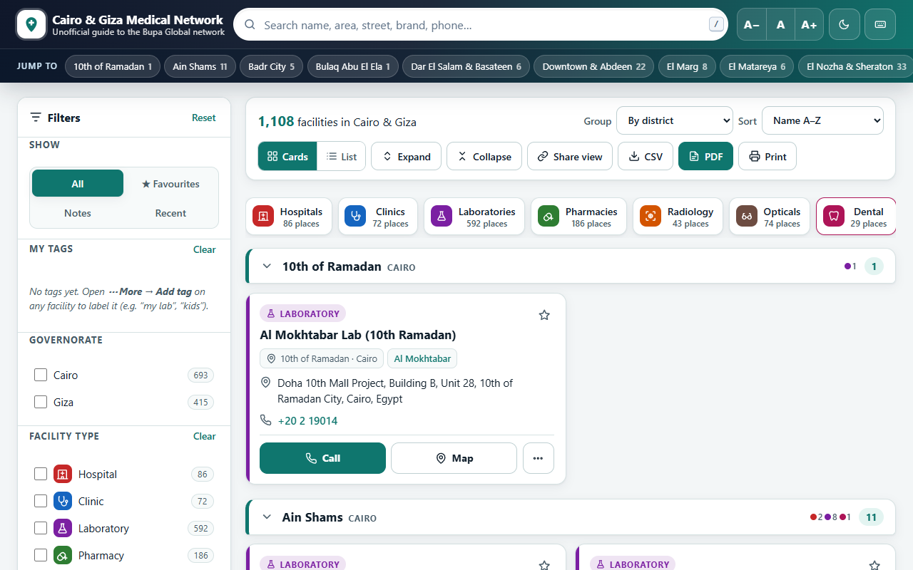
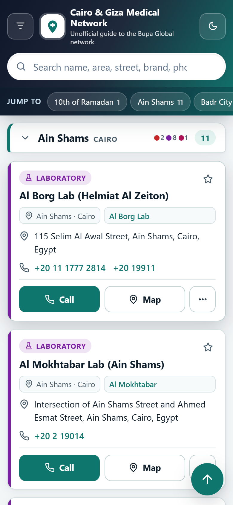
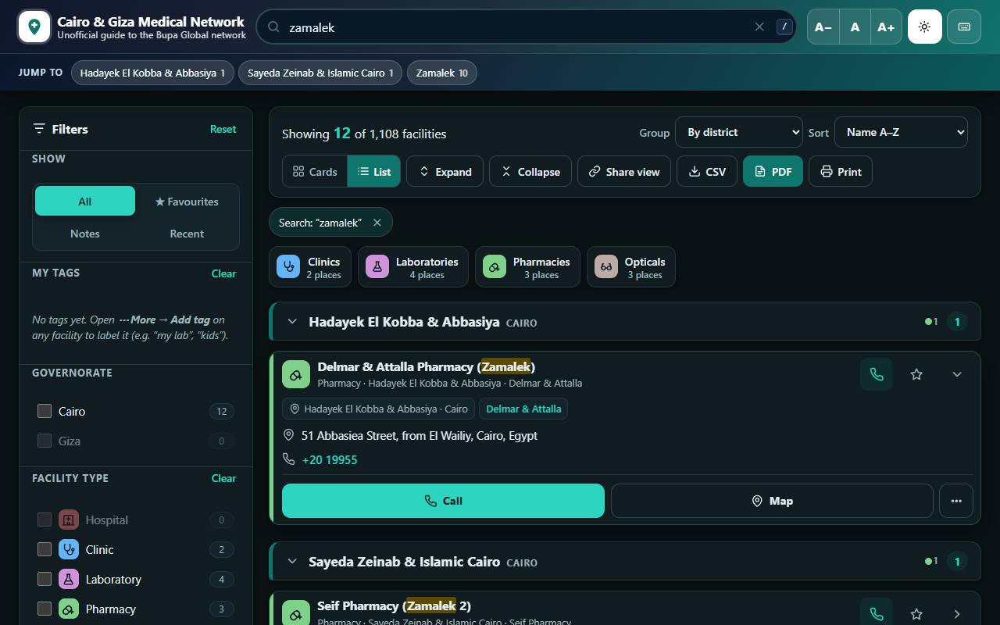
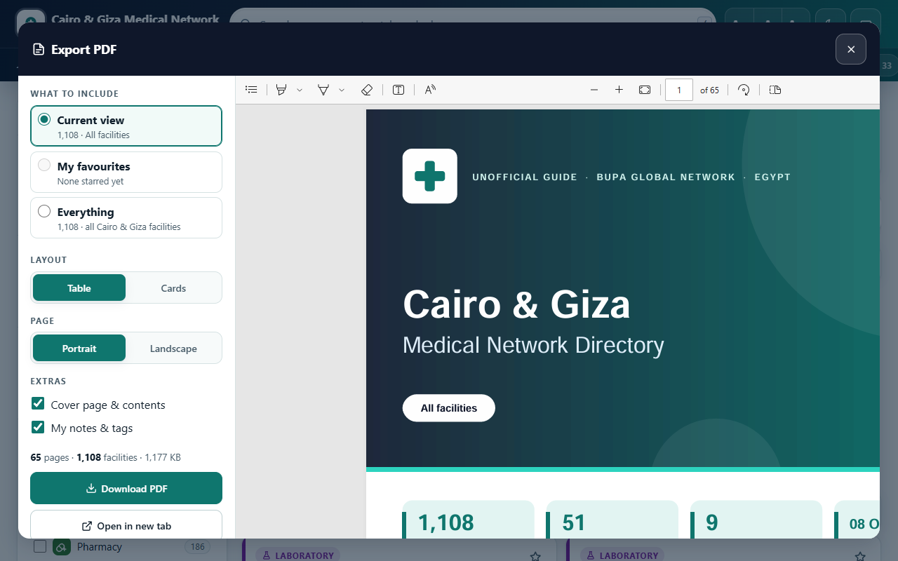
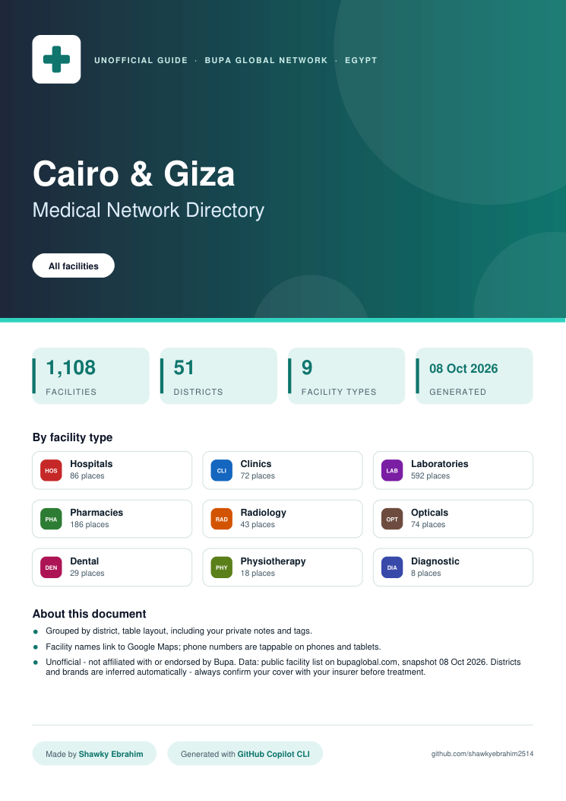
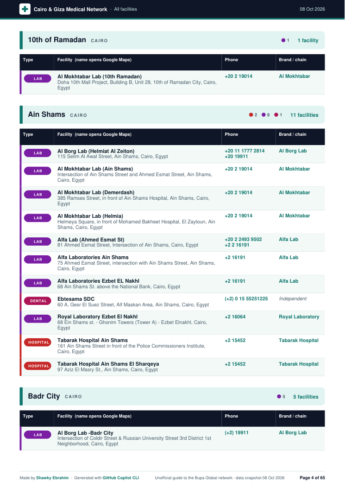
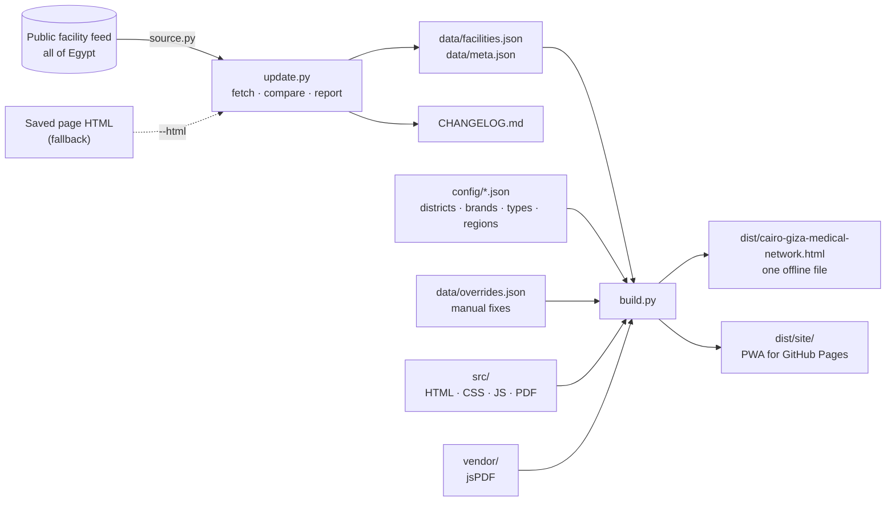

<div align="center">


# Cairo & Giza Medical Network

**An unofficial, offline-friendly guide to the Bupa Global medical network in Cairo & Giza.**
Search, filter, map and call 1,100+ hospitals, clinics, labs, pharmacies and more – in one fast page.

[](https://github.com/shawkyebrahim2514/cairo-giza-medical-network/actions/workflows/deploy.yml)
[](CHANGELOG.md)
[](https://github.com/shawkyebrahim2514/cairo-giza-medical-network/actions/workflows/update-data.yml)
[](https://github.com/shawkyebrahim2514/cairo-giza-medical-network/releases/latest)
[-334155)](LICENSE)

**[🌐 Open the live site](https://shawkyebrahim2514.github.io/cairo-giza-medical-network/)** ·
**[📄 Download the offline file](https://github.com/shawkyebrahim2514/cairo-giza-medical-network/releases/latest)** ·
**[📝 What changed](CHANGELOG.md)**

</div>

> [!IMPORTANT]
> **Unofficial project** – not affiliated with or endorsed by Bupa or Bupa Global. The data is a periodic snapshot of
> their public facility list and may be out of date. **Always confirm your cover with your insurer before treatment.**
> See [DISCLAIMER.md](DISCLAIMER.md).

<p align="center">
  
  
</p>

---

## Contents

- [Features](#features)
- [Quick start](#quick-start)
- [How it works](#how-it-works)
- [Scripts at a glance](#scripts-at-a-glance)
- [Automation (GitHub Actions)](#automation-github-actions)
- [Repository layout](#repository-layout)
- [Documentation](#documentation)
- [Roadmap](#roadmap)
- [Credits & licence](#credits--licence)

## Features

| | |
|---|---|
| 🔎 **Find** | Typo-tolerant search over name, area, street, brand and phone · understands nicknames (*tagamoa* → New Cairo, *mohandeseen* → Mohandessin) · filters for governorate, district, facility type, brand/chain and your own tags · results grouped by district, type or brand with a *Jump to* bar · cards or compact list view |
| 📞 **Act** | One-tap **Call** and **Map** (Google Maps) · copy details · share a facility · **Share view** copies a link to exactly what you're looking at (search + filters) |
| ⭐ **Personal** | Favourites, private notes, custom tags (`#my lab`, `#kids`), recently used – stored only in your browser · backup & restore to a file |
| 🖨️ **Export** | Designed **PDF** with live preview (table or cards, portrait or landscape, cover & clickable contents, your notes) · **CSV** for Excel · print |
| 🌗 **Comfort** | Dark mode · text size · keyboard shortcuts (`/` search, `Esc` clear, `?` help, `t` top) · works on phones without sideways scrolling · accessible (keyboard, screen readers) |
| 📲 **Anywhere** | One self-contained HTML file (works offline from a USB stick / WhatsApp / e-mail) · the live site installs as an app and works offline after the first visit |
| 🔄 **Fresh** | A weekly check opens a pull request with a readable change report when the list changes |

<details>
<summary><b>More screenshots</b></summary>
<br>
<p align="center">
  <br><br>
  <br><br>
  
  
</p>
</details>

## Quick start

### 1. Just use it
- **Online:** open the [live site](https://shawkyebrahim2514.github.io/cairo-giza-medical-network/). On a phone,
  use *Install app* (footer) or *Add to Home screen*.
- **Offline:** download `cairo-giza-medical-network.html` from the
  [latest release](https://github.com/shawkyebrahim2514/cairo-giza-medical-network/releases/latest) and open it in
  any browser. Nothing to install, no internet needed.

### 2. Build it yourself
Requires **Python 3.10+** only – the build uses no third-party packages.

```bash
git clone https://github.com/shawkyebrahim2514/cairo-giza-medical-network.git
cd cairo-giza-medical-network
python scripts/build.py
# → dist/cairo-giza-medical-network.html   (open it in a browser)
```

### 3. Maintain it
```bash
python scripts/update.py --dry-run   # what changed on the live list? (writes nothing)
python scripts/update.py             # update data + CHANGELOG, then rebuild
git add -A && git commit -m "Data update" && git push   # → site + release update automatically
```

## How it works



1. **Data** – `update.py` downloads the list (the same JSON the official page uses), normalises it and keeps
   **all of Egypt** in `data/facilities.json`, one facility per line so changes are easy to review.
2. **Enrichment** – at build time each facility gets a **district** (from address keywords), a **brand/chain**
   (from its name) and clean, dialable **phone links**. Manual corrections in `data/overrides.json` win.
3. **Build** – `build.py` inlines the CSS, JavaScript, data and PDF library into **one HTML file** and also writes a
   website version with an app manifest, a service worker (offline) and icons.

## Scripts at a glance

| Script | What it does | Typical use |
|---|---|---|
| [`scripts/update.py`](docs/SCRIPTS.md#updatepy) | Fetch the latest list, compare with the saved data, write a change report, update `CHANGELOG.md`, rebuild | `python scripts/update.py --dry-run` |
| [`scripts/build.py`](docs/SCRIPTS.md#buildpy) | Bundle everything into the single offline file + the website | `python scripts/build.py --site egypt` |
| [`scripts/screenshots.py`](docs/SCRIPTS.md#screenshotspy) | Re-take the README screenshots | after UI changes |
| [`scripts/source.py`](docs/SCRIPTS.md#sourcepy) | Reads the live feed or a saved HTML page (used by `update.py`) | – |
| [`scripts/enrich.py`](docs/SCRIPTS.md#enrichpy) | Districts, brands, phone links, overrides (used by `build.py`); run directly to audit districts | `python scripts/enrich.py -u` |
| [`tests/ui_test.py`](docs/SCRIPTS.md#tests), [`tests/pdf_test.py`](docs/SCRIPTS.md#tests) | Browser tests (Playwright) | `python tests/ui_test.py` |

Every option, input, output and exit code is documented in **[docs/SCRIPTS.md](docs/SCRIPTS.md)**.

## Automation (GitHub Actions)

| Workflow | When | What |
|---|---|---|
| **Check for data updates** ([`update-data.yml`](.github/workflows/update-data.yml)) | Mondays 06:00 UTC, or manually | Runs `update.py`. If the list changed, opens/updates a pull request **`data-update`** whose description is the change report (added / removed / changed, Cairo & Giza first). If nothing changed, commits the new **last checked** date to `main` and redeploys. |
| **Build & deploy** ([`deploy.yml`](.github/workflows/deploy.yml)) | Every push to `main` touching the app/data, PRs, or manually | Build → UI & PDF tests → publish to **GitHub Pages** → create/update the release **`data-YYYY-MM-DD`** with the single offline file attached. |
| **Dependabot** ([`dependabot.yml`](.github/dependabot.yml)) | Monthly | One pull request that bumps the GitHub Actions versions; merge when the checks pass. |

**Dates and releases:** *data as of* (`snapshot` in `data/meta.json`) is the last day the facility list **changed** –
it names the release tag `data-YYYY-MM-DD`, so a new release appears only when the data changes. *Last checked* is the
last day the list was **confirmed** as current. Every redeploy rebuilds the offline file and replaces it in the
existing release (the notes show the data date, last checked date, build time and commit).

**When a data-update PR arrives:** read the report, spot-check anything odd (e.g. a new facility in *Other Cairo* →
teach its district in `config/districts.json`, see [RECIPES](docs/RECIPES.md#a-facility-is-in-other-cairo--wrong-district)),
then merge. The site and release update by themselves.

<details>
<summary><b>One-time GitHub setup</b></summary>

1. **Settings → Pages → Build and deployment → Source:** *GitHub Actions*.
2. **Settings → Actions → General → Workflow permissions:** tick *Allow GitHub Actions to create and approve pull requests*.
3. **Actions → Check for data updates → Run workflow** once, to confirm the feed is reachable from GitHub's servers.
   If it fails with "could not fetch", run `python scripts/update.py` on your own computer and push instead.
4. Optional: **About (⚙️)** → add the website URL and topics.

Pull requests opened by the bot don't trigger the test workflow themselves (GitHub's rule for its built-in token);
merging does, and a failing build never gets deployed.
</details>

## Repository layout

```
├── src/                     the app, split for easy editing
│   ├── index.html             page structure (placeholders like __AREA__ are filled by build.py)
│   ├── styles.css             all styles, light + dark palettes
│   ├── app.js                 search, filters, favourites, notes, tags, exports …
│   ├── pdf.js                 PDF export (included into app.js at build time)
│   ├── manifest.webmanifest   app install info (website only)
│   ├── sw.js                  service worker: offline support (website only)
│   └── icons/                 app icons
├── data/
│   ├── facilities.json        the facility list – all of Egypt (updated by update.py)
│   ├── meta.json              data date ("snapshot"), last-checked date, source, count
│   ├── overrides.json         your manual corrections (never overwritten)
│   └── raw/                   saved HTML pages – local only, git-ignored
├── config/
│   ├── districts.json         address keywords → district, search nicknames
│   ├── brands.json            name pattern → brand/chain
│   ├── types.json             facility types: labels + display order
│   └── regions.json           city spelling fixes + which governorates each site shows
├── scripts/                 update.py · build.py · screenshots.py · source.py · enrich.py · common.py
├── tests/                   Playwright UI + PDF tests
├── vendor/                  jsPDF + AutoTable (MIT), inlined into the build
├── docs/                    SCRIPTS.md · DATA.md · RECIPES.md · screenshots/
├── .github/                 workflows/ (deploy · update-data) · dependabot.yml · ISSUE_TEMPLATE/ (wrong-info form)
├── CHANGELOG.md             data changes over time (written by update.py)
└── dist/                    build output – git-ignored
```

## Documentation

| Document | Contents |
|---|---|
| **[docs/SCRIPTS.md](docs/SCRIPTS.md)** | Every script and test: purpose, options, inputs/outputs, exit codes, examples |
| **[docs/DATA.md](docs/DATA.md)** | Data files and config formats: facilities, meta, overrides, districts, brands, types, regions; how the browser stores your data |
| **[docs/RECIPES.md](docs/RECIPES.md)** | Step-by-step how-tos (fix a facility, add a district/brand/region, change colours, manual release, upgrade jsPDF) and troubleshooting |
| [CHANGELOG.md](CHANGELOG.md) | Data updates over time |
| [DISCLAIMER.md](DISCLAIMER.md) | Data source, no warranty, removal requests, privacy |

## Roadmap

- [x] Searchable single-file directory with filters, favourites, notes, tags
- [x] Designed PDF export with preview
- [x] Split source, JSON data, automated weekly updates with change reports
- [x] GitHub Pages site, installable offline app, releases
- [ ] **Map view** – facilities as pins on a map, filtered with the current search (needs internet for map tiles; addresses must be geocoded once and cached)
- [ ] *Maybe:* more regions as separate sites (Alexandria, …) · Arabic interface · "near me" sorting

Spotted a wrong phone number, address or district? **[Report wrong info](https://github.com/shawkyebrahim2514/cairo-giza-medical-network/issues/new?template=wrong-info.yml)**
(also linked from the page footer). Other ideas are welcome in [Issues](https://github.com/shawkyebrahim2514/cairo-giza-medical-network/issues).

## Credits & licence

Made by **[Shawky Ebrahim](https://github.com/shawkyebrahim2514)** · built with **GitHub Copilot CLI**.
PDF export uses [jsPDF](https://github.com/parallax/jsPDF) and [jsPDF-AutoTable](https://github.com/simonbengtsson/jsPDF-AutoTable) (MIT).

The **code** is [MIT-licensed](LICENSE). The **facility data** is not – it belongs to its owner and is included
for personal, non-commercial reference only. See [DISCLAIMER.md](DISCLAIMER.md); removal requests are honoured promptly.
